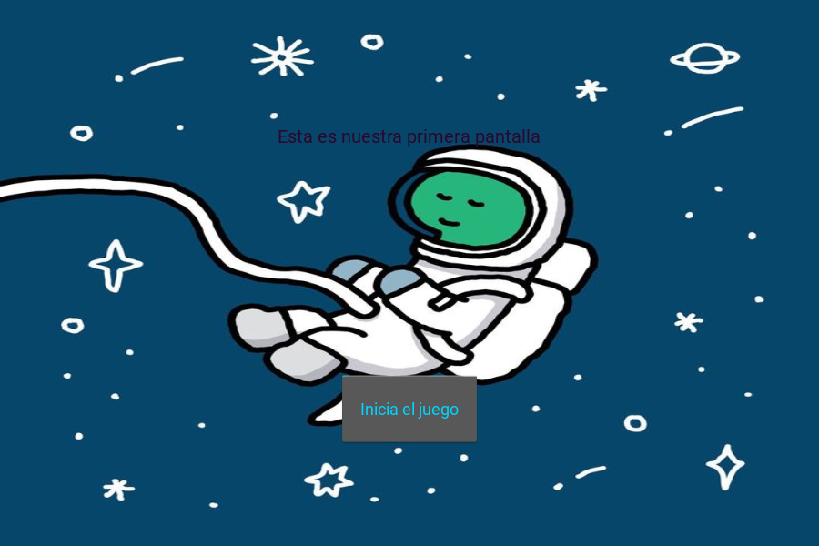
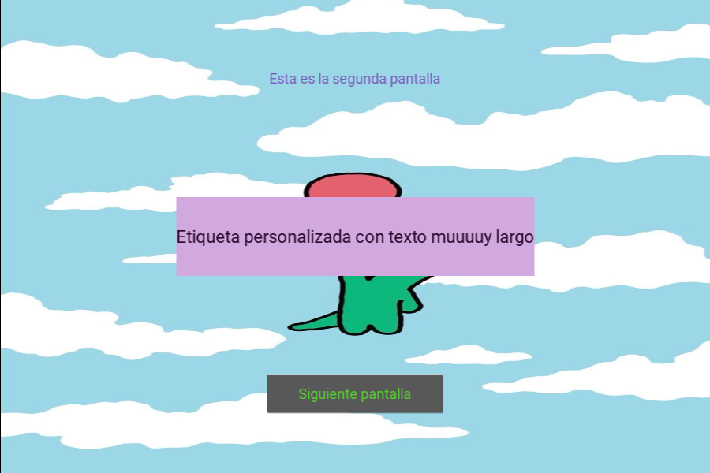
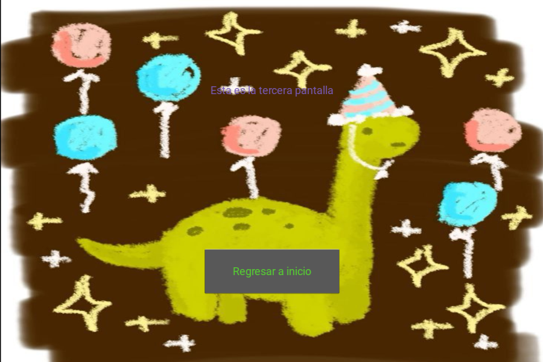

# Juego Dinos: de un script de Kivy a una app instalable (APK de Android e IPA de iOS) con GitHub Actions

Este repositorio es una **guía práctica y comentada**. Parte de una app pequeña hecha con
[Kivy](https://kivy.org) (un juego de 3 pantallas con dinosaurios) y muestra **cómo convertirla
en un archivo instalable para Android (`.apk`) y para iPhone (`.ipa`) usando GitHub Actions**, sin
instalar nada de Android ni de Apple en tu ordenador.

Está escrito para alguien que **nunca ha usado GitHub Actions**: primero se explican los conceptos
desde cero, luego la estructura del repositorio, y después, **línea por línea**, qué hace cada archivo
de configuración y **por qué** está así.

| Pantalla 1 | Pantalla 2 | Pantalla 3 |
|---|---|---|
|  |  |  |

## Índice

1. [Resultado: qué se obtiene y dónde descargarlo](#1-resultado-qué-se-obtiene-y-dónde-descargarlo)
2. [El problema: ¿por qué no basta con «copiar el .py al teléfono»?](#2-el-problema-por-qué-no-basta-con-copiar-el-py-al-teléfono)
3. [Conceptos desde cero](#3-conceptos-desde-cero) (Git, GitHub, GitHub Actions, workflow, YAML, runner, job, step, artifact, caché)
4. [Las herramientas que empaquetan la app](#4-las-herramientas-que-empaquetan-la-app) (buildozer, python-for-android, kivy-ios)
5. [Estructura del repositorio y por qué tiene que ser así](#5-estructura-del-repositorio-y-por-qué-tiene-que-ser-así)
6. [Los cambios al script original (todos) y por qué](#6-los-cambios-al-script-original-todos-y-por-qué)
7. [`buildozer.spec` línea por línea](#7-buildozerspec-línea-por-línea)
8. [`android.yml` explicado](#8-androidyml-explicado)
9. [`ios.yml` explicado](#9-iosyml-explicado)
10. [Cómo lanzar los builds y descargar los archivos](#10-cómo-lanzar-los-builds-y-descargar-los-archivos)
11. [Cómo instalar la app en el teléfono](#11-cómo-instalar-la-app-en-el-teléfono)
12. [Bitácora real: lo que falló y cómo se arregló](#12-bitácora-real-lo-que-falló-y-cómo-se-arregló)
13. [Probar la app en el PC](#13-probar-la-app-en-el-pc)
14. [Preguntas frecuentes y límites](#14-preguntas-frecuentes-y-límites)
15. [Créditos](#15-créditos)

---

## 1. Resultado: qué se obtiene y dónde descargarlo

Cada vez que se sube código a la rama `main`, GitHub construye **dos archivos**:

| Archivo | Para qué | Dónde se descarga |
|---|---|---|
| `juego-apk` → contiene un `.apk` | Instalar en un teléfono **Android** | pestaña **Actions** → ejecución *Build Android (APK)* → sección **Artifacts** |
| `juego-ios` → contiene un `Juego-Dinos-unsigned.ipa` | Instalar en un **iPhone** (hay que firmarlo, ver [§11](#11-cómo-instalar-la-app-en-el-teléfono)) | pestaña **Actions** → ejecución *Build iOS (IPA sin firmar)* → sección **Artifacts** |

> Un *artifact* es un archivo que un build deja disponible para descargar. Se conservan 90 días.

> **Estado de la verificación:** los dos builds terminaron en verde y se **abrieron los archivos
> resultantes** para comprobar que dentro están `main.py`, `App_juego.kv` y las 3 imágenes (y que
> **no** se coló `docs/`). **No se han instalado en un teléfono real**: eso queda por comprobar.

---

## 2. El problema: ¿por qué no basta con «copiar el .py al teléfono»?

En el PC ejecutas `python main.py` y funciona porque el PC **tiene Python y Kivy instalados**. Un
teléfono no los tiene, y no puedes instalarlos como en un PC. Para que una app de Python se instale
como cualquier otra app, hay que **empaquetar dentro del propio archivo instalable**:

1. Un **intérprete de Python** compilado para el procesador del teléfono (ARM).
2. **Kivy** y sus librerías de gráficos/sonido (SDL2…), también compiladas para ese procesador.
3. **Tu código** (`main.py`, el `.kv`) y tus **recursos** (imágenes).
4. Un pequeño «arrancador» nativo (en Java/Kotlin en Android, en Objective-C en iOS) que inicia
   Python y le pasa el control.

Hacer eso a mano exige instalar el SDK y el NDK de Android (varios GB) y, para iOS, un **Mac con
Xcode**. Con **GitHub Actions** lo hacemos en ordenadores de GitHub, **sin instalar nada en tu equipo**,
y de forma **repetible**: cualquiera que haga `git push` obtiene el mismo resultado.

---

## 3. Conceptos desde cero

### Git, repositorio, commit, push
- **Git** es un programa que guarda el **historial** de cambios de una carpeta.
- Un **repositorio** («repo») es esa carpeta con su historial.
- Un **commit** es una «foto» con nombre de los archivos en un momento dado.
- **`git push`** sube tus commits a GitHub.
- Una **rama** (*branch*) es una línea de historia; `main` es la principal.

### GitHub
Sitio web que **aloja** repositorios en Internet. Además ofrece servicios sobre ellos; uno es **GitHub Actions**.

### GitHub Actions
Es un servicio de GitHub que **ejecuta programas automáticamente cuando pasa algo en el repositorio**
(por ejemplo, cuando haces `git push`). Lo usan los equipos para probar código, compilarlo y
publicarlo sin hacerlo a mano. Es **gratis en repositorios públicos** (en privados hay una cuota mensual
limitada, y los minutos en macOS cuentan ×10).

Piezas, de la más grande a la más pequeña:

| Concepto | Qué es | En este repo |
|---|---|---|
| **Workflow** | Una «receta» automática. Es **un archivo `.yml`**. | `android.yml` y `ios.yml` |
| **Evento / disparador** (`on:`) | Lo que hace que la receta se ejecute | un `push` a `main`, o un botón manual (`workflow_dispatch`) |
| **Job** | Un trabajo dentro de la receta. Cada job corre en **su propio ordenador** | `apk` (en `android.yml`) y `ios` (en `ios.yml`) |
| **Runner** | El ordenador virtual **temporal** que GitHub presta para ejecutar un job. Nace vacío y **se destruye** al terminar | `ubuntu-24.04` (Linux) y `macos-15` (Mac) |
| **Step** (paso) | Una instrucción del job: un comando de terminal (`run:`) o una «acción» ya hecha por otros (`uses:`) | «instalar Python», «compilar APK»… |
| **Action** | Un paso reutilizable publicado por alguien (`actions/checkout@v4`, etc.) | `checkout`, `setup-python`, `cache`, `upload-artifact` |
| **Artifact** | Archivo que el job guarda para poder **descargarlo** después | el `.apk` y el `.ipa` |
| **Caché** | Carpeta que se guarda entre ejecuciones para **no repetir descargas largas** | SDK/NDK de Android; toolchain de iOS |
| **Log** | El «diario» de todo lo que imprimió cada paso. **Es lo que lees cuando algo falla** | pestaña Actions → clic en la ejecución |

> Idea clave: como el runner **se destruye** al final, *todo* lo que quieras conservar (el APK) hay que
> subirlo explícitamente como artifact. Y como **nace vacío**, *todo* lo que necesitas (Python, Java,
> buildozer) hay que instalarlo en los primeros pasos. Por eso los workflows son largos.

### YAML: el formato de los workflows
Los workflows se escriben en **YAML**, un formato de texto basado en **indentación** (espacios, nunca
tabuladores). Lo único que necesitas saber:

```yaml
nombre: valor            # una clave y su valor
lista:                   # una lista: cada elemento empieza con "- "
  - uno
  - dos
bloque: |                # "|" = un texto de varias líneas (aquí, varios comandos)
  comando 1
  comando 2
cond: ${{ ... }}         # ${{ ... }} = una expresión que GitHub calcula (p. ej. hashFiles)
# esto es un comentario
```

Si la indentación está mal, GitHub rechaza el archivo. Por eso los workflows de este repo están
**comentados línea a línea** (los comentarios empiezan con `#`).

### ¿Por qué los workflows están en `.github/workflows/`?
Porque es **la única carpeta donde GitHub busca** archivos de Actions. Si pones `android.yml` en otra
parte, GitHub lo ignora. El nombre del archivo `.yml` es libre; la **carpeta no**.

---

## 4. Las herramientas que empaquetan la app

Android e iOS son sistemas muy distintos, así que usan **herramientas distintas**:

| | Android | iOS |
|---|---|---|
| Archivo final | `.apk` (un `.zip` con el código y las librerías) | `.ipa` (un `.zip` con una carpeta `Payload/` que contiene la `.app`) |
| Herramienta principal | **buildozer** | **kivy-ios** (`toolchain`) |
| Herramienta «de fondo» | **python-for-android** (p4a): compila Python y Kivy para Android; buildozer lo maneja por ti | **Xcode** (`xcodebuild`): el compilador de Apple |
| Se configura con | `buildozer.spec` | argumentos de `toolchain` y del workflow |
| Dónde corre | Linux (`ubuntu-24.04`) | **solo macOS** (`macos-15`): Xcode no existe en Linux ni Windows |
| ¿Firma? | El APK de *debug* se firma solo con una clave de pruebas → **se instala directo** | Apple **exige** firma. Aquí se genera **sin firmar** y se firma al instalar |

**¿Por qué «sin firmar» en iOS?** Para firmar hace falta un certificado de Apple Developer (99 USD/año).
Compilamos sin firma y dejamos que herramientas como **Sideloadly** firmen el `.ipa` en el momento de
instalarlo con tu Apple ID gratuito (ver [§11](#11-cómo-instalar-la-app-en-el-teléfono)).

---

## 5. Estructura del repositorio y por qué tiene que ser así

```
kivy-juego-dinos/
├── main.py                       ← el código de la app. El nombre es OBLIGATORIO
├── App_juego.kv                  ← la interfaz (pantallas y botones) en lenguaje KV
├── App_dino1.jpg                 ← imágenes de fondo, junto a main.py
├── App_dino3.jpg
├── App_dino4.jpg
├── buildozer.spec                ← configuración del APK (nombre, versión, permisos…)
├── requirements.txt              ← solo para ejecutar en el PC (no lo usan los builds)
├── .gitignore                    ← lista de archivos que Git debe ignorar
├── docs/capturas/…               ← capturas que ves arriba (solo documentación)
└── .github/
    └── workflows/                ← carpeta OBLIGATORIA para GitHub Actions
        ├── android.yml           ← receta del build de Android
        └── ios.yml               ← receta del build de iOS
```

| Elemento | Por qué está ahí / por qué se llama así |
|---|---|
| `main.py` | **Android e iOS arrancan siempre el archivo llamado `main.py`** de la raíz. No es una convención opcional: si se llama distinto, la app empaquetada no encuentra qué ejecutar. El script original se llamaba `App_juego.py`. |
| `App_juego.kv` | Se queda con su nombre original; `main.py` lo carga por nombre. |
| Imágenes **junto a** `main.py` | El `.kv` las nombra como `'App_dino4.jpg'` (ruta relativa). Deben viajar dentro de la app y estar donde el código las busque. En el script original estaban **una carpeta más arriba** (en `Apps_Kivy/`), no en `App Juego/`: había que traerlas. |
| Todo en la **raíz** | `buildozer.spec` tiene `source.dir = .` (la raíz). Poner el código en subcarpetas es posible, pero complica la configuración sin beneficio para una app tan pequeña. |
| `buildozer.spec` en la **raíz** | buildozer lo busca en la carpeta desde la que se ejecuta. |
| `.github/workflows/` | Único sitio donde GitHub busca los workflows (ver [§3](#3-conceptos-desde-cero)). |
| `docs/` | Para documentación. **Se excluye del APK/IPA** (ver `source.exclude_dirs` y el `rsync` de `ios.yml`): son capturas, no forman parte de la app. |
| `.gitignore` | Evita subir carpetas que se generan solas o son de tu PC (`.venv/`, `.buildozer/`, `bin/`…) y que **pesan cientos de MB**. |
| `requirements.txt` | Útil para `pip install -r requirements.txt` en el PC. **Los builds no lo leen**: en Android las dependencias van en `requirements =` de `buildozer.spec`. |

---

## 6. Los cambios al script original (todos) y por qué

El script original está en el repositorio
[`AndreaOchoaC/Apps_Kivy`](https://github.com/AndreaOchoaC/Apps_Kivy), carpeta `App Juego/`. Esta es
la lista **completa** de lo que se cambió.

### 6.1 Cambios de archivos (no tocan el código)

| # | Cambio | Por qué |
|---|---|---|
| A | `App_juego.py` → **`main.py`** (renombrado) | Android e iOS arrancan `main.py` (ver [§5](#5-estructura-del-repositorio-y-por-qué-tiene-que-ser-así)). |
| B | Se **copiaron** `App_dino1.jpg`, `App_dino3.jpg` y `App_dino4.jpg` desde `Apps_Kivy/` junto a `main.py` | El `.kv` las usa y no estaban en la carpeta de la app. **Si faltan, Kivy no da ningún error**: simplemente dibuja los fondos vacíos. Se comprobó ejecutando el original: cero avisos. Es una trampa silenciosa. (`App_dino2.jpg` **no** se copia: ninguna pantalla la usa.) |
| C | **No** se copiaron `Juego_aoc.py/.kv` ni las imágenes `stars*.jpg`, `dinos*.jpg`, `grid*.jpg` | Esa es **otra app** distinta en la misma carpeta. Un APK lleva **una sola app**. |
| D | `App_juego.kv` **no se modificó** (se verificó que es idéntico byte a byte salvo los saltos de línea) | No hizo falta. |
| E | Se añadieron `buildozer.spec`, `.github/workflows/*.yml`, `.gitignore`, `requirements.txt`, `docs/` y este `README.md` | Son la «maquinaria» de empaquetado y documentación. |

> **Saltos de línea:** los archivos originales usan finales de línea de Windows (CRLF). Git los
> normaliza al subirlos (`core.autocrlf`). Python y Kivy aceptan ambos, así que no es un cambio funcional.

### 6.2 Cambios dentro de `main.py`

Este es el **diff real** (generado con `diff -u`) entre el original y `main.py`:

```diff
--- App Juego/App_juego.py (original)
+++ main.py (nuevo)
@@ -2,12 +2,23 @@
 # Aplicación con varias pantallas y botones para navegar entre ellas
 # usaremos un archivo .kv para definir la interfaz gráfica
 
+import os  # CAMBIO 1 (ver README): para averiguar en qué carpeta está este archivo
+
 from kivy.lang import Builder
 from kivy.app import App
+from kivy.resources import resource_add_path  # CAMBIO 1
 from kivy.uix.screenmanager import ScreenManager, Screen
 from kivy.core.window import Window
 from kivy.uix.button import Button
 
+# CAMBIO 1: carpeta donde vive este archivo. En el PC es la carpeta del proyecto; en el
+# teléfono es la carpeta privada donde Android/iOS instala la app. Así el código no depende
+# de "desde qué carpeta se ejecutó".
+BASE = os.path.dirname(os.path.abspath(__file__))
+# Le decimos a Kivy que busque ahí también las imágenes (App_dino1.jpg, etc.) que se
+# nombran dentro del archivo .kv.
+resource_add_path(BASE)
+
 class Pantalla1(Screen):
     pass
 
@@ -20,7 +31,10 @@
 class WindowManager(ScreenManager):
     pass
 
-kv = Builder.load_file("App_juego.kv")
+# CAMBIO 2: antes era Builder.load_file("App_juego.kv"), una ruta relativa. En el PC también
+# funcionaba (Kivy busca junto al script), pero así no dependemos de ello: en el teléfono la
+# carpeta de trabajo no es la nuestra. Ahora la ruta es absoluta (BASE + nombre del archivo).
+kv = Builder.load_file(os.path.join(BASE, "App_juego.kv"))
 
 class AppJuego(App):
     #Window.clearcolor = (.5, 1, .2, 1)  # Establecer el color de fondo de la ventana
```

**CAMBIO 1: `BASE` y `resource_add_path(BASE)`**
- `os.path.abspath(__file__)` es la ruta completa de `main.py`; `dirname(...)` es su carpeta. Esa carpeta
  es `BASE`.
- `resource_add_path(BASE)` le dice a Kivy: «cuando el `.kv` pida la imagen `App_dino4.jpg`, búscala
  también en `BASE`».
- **Por qué:** en un teléfono, la «carpeta actual» desde la que se ejecuta Python **no es la carpeta
  de tu proyecto**: es una carpeta privada que crea el sistema. Anclarnos a la ubicación del propio archivo
  evita depender de eso.
- **Honestidad:** no es estrictamente obligatorio. Se comprobó que el script original **también arranca
  desde otra carpeta en el PC**, porque Kivy ya busca recursos junto al script ejecutado. Se añadió como
  **medida preventiva**, porque en el móvil no se pudo probar sin ella y cuesta una media hora de build
  descubrir que hacía falta. Si la quitas, probablemente seguiría funcionando.

**CAMBIO 2: `Builder.load_file(os.path.join(BASE, "App_juego.kv"))`**
- Antes: ruta relativa `"App_juego.kv"`. Ahora: ruta **absoluta** (`BASE` + nombre).
- **Por qué:** mismo motivo que el CAMBIO 1. Misma salvedad: preventivo, no obligatorio.

### 6.3 Cosas del original que **no** se tocaron (y por qué)

| Línea | Qué hace | Por qué se deja |
|---|---|---|
| `Window.size = (600, 400)` | Fija el tamaño de la ventana | **En un móvil se ignora** (la app ocupa toda la pantalla). Sigue sirviendo en el PC. Por eso `buildozer.spec` fija la orientación horizontal: la proporción 600×400 es apaisada. |
| `#Window.clearcolor = ...` (comentada) | Color de fondo | No se usa. |
| `from kivy.uix.button import Button` | Importación no usada | Inofensiva. |
| Clases `Pantalla1/2/3`, `WindowManager` | Pantallas | Funcionan igual. |

---

## 7. `buildozer.spec` línea por línea

Es el archivo de configuración de buildozer. Se puede generar con `buildozer init`, pero aquí está escrito a
mano y **comentado dentro del propio archivo**. Resumen de lo importante:

| Línea | Qué hace | Por qué ese valor |
|---|---|---|
| `title = Juego Dinos` | Nombre bajo el icono | libre |
| `package.name = juegodinos` | Nombre interno | solo minúsculas/números, **sin espacios ni `_`** |
| `package.domain = org.clase` | «Dominio al revés» | Forma el identificador único `org.clase.juegodinos`. Android no deja instalar dos apps con el mismo id |
| `source.dir = .` | Dónde está el código | la raíz (ahí está `main.py`) |
| `source.include_exts = py,png,jpg,kv,atlas` | Qué tipos de archivo se empaquetan | **Si falta `jpg`, las imágenes no entran y no hay error**. Es el fallo más típico |
| `source.exclude_dirs = docs,.github,.git` | Carpetas que no se empaquetan | las capturas de `docs/` son `.png` y entrarían por error |
| `requirements = python3,kivy` | Librerías que la app usa | solo Kivy. Si usas otra librería, se añade aquí |
| `orientation = landscape` | Horizontal | la ventana original es 600×400 |
| `android.archs = arm64-v8a, x86_64` | Procesadores soportados | arm64 = casi todos los móviles; x86_64 = emuladores |
| `android.api = 33` / `android.ndk = 25b` | Versión de Android y de las herramientas nativas | combinación **probada** con el p4a de abajo |
| `android.accept_sdk_license = True` | Acepta la licencia de Google | **Sin esto el build falla en la nube** (ver [§12](#12-bitácora-real-lo-que-falló-y-cómo-se-arregló)) |
| `p4a.branch = v2024.01.21` | Fija la versión de python-for-android | Si no se fija, usa la última, que empaqueta Python 3.14, con el que Kivy 2.3 **no compila** |

---

## 8. `android.yml` explicado

Archivo: [`.github/workflows/android.yml`](.github/workflows/android.yml) (con comentarios dentro). Estructura y razones:

| Parte | Qué hace | Por qué |
|---|---|---|
| `name:` | Nombre visible en la pestaña Actions | |
| `on: push: branches: [main]` | Se ejecuta con cada `git push` a `main` | automatiza: subir código ⇒ APK nuevo |
| `paths-ignore: ["**.md","docs/**"]` | No ejecutar si solo cambió documentación | ahorra 30 minutos de build por corregir una coma del README |
| `on: workflow_dispatch` | Añade un botón **Run workflow** | para lanzarlo a mano sin tocar el código |
| `runs-on: ubuntu-24.04` | Runner Linux | buildozer funciona bien en Linux |
| `timeout-minutes: 90` | Corta si se cuelga | evita gastar horas por un bloqueo |
| 1. `actions/checkout@v4` | Descarga tu código al runner | el runner nace **vacío** |
| 2. `actions/setup-python@v5` (3.11) | Instala Python | buildozer es un programa de Python. Es el Python que **ejecuta** buildozer, no el que va dentro de la app |
| 3. `apt-get install …` | Instala programas del sistema (Java, compiladores…) | `libltdl-dev` y `libtool-bin` arreglan el fallo de `libffi` |
| 4. `pip install buildozer … cython==0.29.34` | Instala buildozer | Cython antiguo porque las recetas de ese p4a no soportan Cython 3 |
| 5. `actions/cache@v4` | Guarda/recupera `~/.buildozer` (SDK, NDK…) | la 1.ª vez se descargan ~2 GB; con caché, las siguientes veces se reutilizan |
| `key: buildozer-${{ hashFiles('buildozer.spec') }}` | Identificador de la caché | `hashFiles` calcula una «huella» del archivo: si cambias `buildozer.spec`, la huella cambia y se crea caché nueva (porque podrían necesitarse otras descargas) |
| 6. `buildozer -v android debug` | **La compilación** | `debug` = APK firmado con clave de pruebas (instalable directo) |
| Bucle `for intento in 1 2 3` alrededor | Reintenta si falla | buildozer descarga cosas de Internet y a veces **una descarga se corta** (`Connection reset by peer`). Es un fallo de red, no del código; reintentar lo resuelve. Si fallan los 3 intentos, el paso falla de verdad |
| 7. `actions/upload-artifact@v4` | Sube `bin/*.apk` | el runner se destruye; sin esto el APK se perdería |
| `if-no-files-found: error` | Falla si no hay APK | así un «verde» siempre significa que **hay** archivo |

---

## 9. `ios.yml` explicado

Archivo: [`.github/workflows/ios.yml`](.github/workflows/ios.yml). Lo que difiere de Android:

| Parte | Qué hace | Por qué |
|---|---|---|
| `runs-on: macos-15` | Runner Mac | **Xcode solo existe en macOS**. Se usa `macos-15` y no `macos-14` porque, en esta cuenta, GitHub rechaza `macos-14` al instante (ver [§12](#12-bitácora-real-lo-que-falló-y-cómo-se-arregló)) |
| `brew install autoconf automake libtool pkg-config` | Herramientas de compilación | **Homebrew** es el gestor de paquetes de Mac (equivale a `apt-get`). Las pide kivy-ios |
| `pip install kivy-ios "cython==3.0.11"` | Instala kivy-ios y Cython | Cython es **obligatorio** (sin él: `Missing requirement: cython is not installed`); 3.0.11 es la última versión que Kivy 2.3.1 admite |
| `toolchain build python3 kivy` | Compila Python y Kivy para iOS | **es lo más lento** (~20 min) y por eso se cachea |
| Caché con `restore` + `save` por separado | Recupera al inicio, guarda justo después de compilar | Si se usa la acción `cache` normal, la caché se guarda **al final del job**… y **solo si todo va bien**. Si un paso posterior fallaba, se perdían los 20 min. Separándolos, se guarda en cuanto termina la parte lenta |
| `rsync … ios-toolchain/app/` | Copia solo los archivos de la app | excluye `.git`, `docs`, `buildozer.spec`… |
| `toolchain create "$APP_TITLE" "$PWD/app"` | Genera un proyecto de Xcode que envuelve la app | kivy-ios no compila tu código: crea un proyecto estándar de iOS que lo incluye |
| `xcodebuild … CODE_SIGNING_ALLOWED=NO` | Compila para iPhone **sin firmar** | no tenemos certificados de Apple |
| `-sdk iphoneos` | Compila para dispositivos reales | (existe también `iphonesimulator`, para el simulador del Mac; no se necesita aquí) |
| `zip -qr …ipa Payload` | Crea el `.ipa` | un `.ipa` **es un zip** con una carpeta `Payload/` que contiene la `.app` |
| `upload-artifact` | Sube el `.ipa` | igual que en Android |

---

## 10. Cómo lanzar los builds y descargar los archivos

**Opción A: automático.** Haz un cambio, y súbelo:

```bash
git add .
git commit -m "Descripción del cambio"
git push
```

**Opción B: manual.** En GitHub: pestaña **Actions** → elige el workflow en la lista de la izquierda →
botón **Run workflow** → rama `main`.

**Seguir el progreso:** pestaña **Actions** → clic en la ejecución → clic en el job → ves cada paso con su log
en directo. Un círculo amarillo = en curso, ✅ = bien, ❌ = falló (clic para ver por qué).

**Descargar:** entra a la ejecución en verde y baja a la sección **Artifacts** → `juego-apk` / `juego-ios`.
Descarga el `.zip` y descomprímelo para obtener el `.apk` / `.ipa`.

**Tiempos reales de este repositorio** (la 1.ª ejecución, sin caché):

Medidos en las ejecuciones que terminaron en verde (la 1.ª de cada una **sin caché**):

| Build | Total | Dónde se va el tiempo |
|---|---|---|
| **Android** | **11 min 26 s** | `Compilar APK`: 10 min 22 s (descargar SDK/NDK y compilar Python + Kivy); instalar dependencias del sistema: 24 s |
| **iOS** | **28 min 26 s** | 5 min **esperando** a que GitHub asigne un Mac libre; `Compilar Python y Kivy para iOS`: 21 min 45 s; guardar caché: 41 s; `xcodebuild` + empaquetar: **solo 20 s** |

Las dos ejecuciones guardaron su caché, así que las siguientes deberían ser **mucho más rápidas** (sobre todo
iOS, donde 22 de los 28 minutos son la parte cacheada). Esa mejora **no se ha medido** todavía.S

---

## 11. Cómo instalar la app en el teléfono

### Android
1. Pasa el `.apk` al teléfono (por cable, Drive, WhatsApp a ti mismo…).
2. Ábrelo. Android avisará de *«Instalar apps desconocidas»*: permítelo **solo para esa app de origen**
   (Chrome, Archivos…). Es normal: el APK no viene de Google Play.
3. Instala y abre **Juego Dinos**.

### iPhone (desde Windows, con un Apple ID gratuito)
El `.ipa` no está firmado, así que se firma con tu Apple ID **al instalarlo**.

**Lo que necesitas:**
- El archivo `Juego-Dinos-unsigned.ipa`.
- Un PC con Windows y un **cable USB**.
- **iTunes** e **iCloud** descargados de apple.com (**no** de la Microsoft Store: esas versiones no funcionan con Sideloadly).
- [**Sideloadly**](https://sideloadly.io) (gratis).
- Un **Apple ID** (el normal de tu iPhone sirve; se crea gratis en [account.apple.com](https://account.apple.com)).
  Recomendado: usar uno **secundario**, porque escribes su contraseña en una herramienta de terceros.
  **No** hace falta la cuenta de pago de 99 USD.

**Pasos:**
1. Conecta el iPhone por USB y acepta *Confiar en este equipo*.
2. Abre Sideloadly, arrastra el `.ipa`, escribe tu Apple ID y pulsa **Start** (te pedirá la contraseña y, si
   tienes verificación en dos pasos, el código que llega al iPhone).
3. En el iPhone: *Ajustes → General → VPN y gestión de dispositivos* → tu Apple ID → **Confiar**.
4. iOS 16 o superior: *Ajustes → Privacidad y seguridad → Modo de desarrollador* → activar y reiniciar.
5. Abre la app **juegodinos** (así se llama en el iPhone: kivy-ios pone el nombre en minúsculas; su identificador es `org.kivy.juegodinos`).

**Límites del Apple ID gratuito:** la app **caduca a los 7 días** (hay que reinstalarla); hay un tope de apps
instaladas a la vez (unas 3 por dispositivo) y de dispositivos/apps nuevas por semana. Con el **mismo Apple ID**
puedes instalar en **varios iPhone**, pero cada uno se conecta por USB y se instala por separado, y cada
instalación caduca por su cuenta. (Las cifras exactas las decide Apple y pueden cambiar.)

---

## 12. Bitácora real: lo que falló y cómo se arregló

Lo que sigue **ocurrió de verdad** al construir este repositorio, en este orden. Es la mejor forma de
aprender a usar Actions: casi nunca sale a la primera, y lo que importa es **saber leer el error**.

| # | Qué pasó | Cómo se vio | Causa real | Arreglo |
|---|---|---|---|---|
| 1 | El build de **iOS** se cancelaba a los pocos segundos (2 intentos) | Anotación roja: `The configuration 'macos-14-arm64-us-default' is not supported`; el job tenía **0 pasos** ejecutados | GitHub **no asigna** el runner `macos-14` a esta cuenta. En otra cuenta (una organización) ese mismo runner sí funcionó, así que **no es un fallo del workflow**. La causa exacta en GitHub no se pudo determinar | Se lanzó un workflow de diagnóstico con varias etiquetas: `macos-15`, `macos-26` y `macos-latest` **sí** arrancaron; `macos-14` no. Se cambió `ios.yml` a **`macos-15`** y se borró el diagnóstico |
| 2 | El build de **Android** falló a los ~2 min | En el log: `Accept? (y/N): Skipping following packages as the license is not accepted` y después `Aidl not found, please install it` | Faltaba `android.accept_sdk_license = True` en `buildozer.spec`. Sin ella, buildozer **pregunta** si aceptas la licencia de Google; en la nube no hay nadie para contestar, el SDK no se instala y falla más adelante con un mensaje que no menciona la licencia. Fue un **olvido** al escribir el archivo | Se añadió la línea (ver [§7](#7-buildozerspec-línea-por-línea)) |
| 3 | El build de **Android** volvió a fallar a los ~2,5 min | `URLError: <urlopen error [Errno 104] Connection reset by peer>` al descargar Apache Ant | **Fallo de red** pasajero: se cortó una descarga. No es un error del proyecto | Se envolvió la compilación en un bucle de **3 reintentos** (ver [§8](#8-androidyml-explicado)) |

> **Por qué importa el nº 2:** el mensaje final del error («Aidl not found») **no** decía «licencia». La causa
> estaba **más arriba en el log**. Regla de oro: **cuando algo falla, no te quedes con la última línea roja;
> sube hasta encontrar el primer error.**

### Problemas de un proyecto anterior, ya prevenidos aquí

Estos errores se descubrieron antes, construyendo una app mayor (Kivy Arcade), y por eso el código de este
repositorio ya los evita. **No se produjeron aquí**, pero conviene conocerlos porque son los que probablemente
encuentres con tu propia app:

| Síntoma | Causa | Dónde está la defensa |
|---|---|---|
| Android: `possibly undefined macro: LT_SYS_SYMBOL_USCORE` (falla `libffi`) | Faltan los paquetes del sistema `libltdl-dev` y `libtool-bin` | `android.yml`, paso «Dependencias del sistema» |
| Android: compila Python 3.14 y Kivy no compila | Sin fijar versión, python-for-android usa la última, que empaqueta Python 3.14 | `buildozer.spec`: `p4a.branch = v2024.01.21` (+ `android.api`/`ndk`) |
| iOS: `Missing requirement: cython is not installed` | kivy-ios necesita Cython y no se instala solo | `ios.yml`: `pip install … "cython==3.0.11"` |
| iOS: `symbol(s) not found for architecture x86_64` | Las librerías de kivy-ios para el **simulador** son solo `arm64` | `ios.yml` **no compila para el simulador** (solo para iPhone), así que el problema no existe aquí |
| iOS: si un paso tardío falla, se pierden 20 min de compilación | La caché normal se guarda **al final del job y solo si todo va bien** | `ios.yml`: caché dividida en `restore` + `save` justo tras la parte lenta |

### Cómo leer un error en Actions (guía rápida)

1. Pestaña **Actions** → entra a la ejecución con ❌ → clic en el job de la izquierda.
2. Los pasos aparecen en orden; el que falló tiene ❌ y se abre solo. Si no, ábrelo.
3. **Mira también las «Annotations»** (resumen de la ejecución): a veces el motivo real está ahí, como en el nº 1.
4. En el log, **busca hacia arriba** la primera línea con `error`, `ERROR`, `failed` o `not found`.
5. Copia esa línea (no la última) a un buscador, o pásasela a quien te ayude.
6. Corrige, haz `git push`, y vuelve a mirar. Si fue un fallo de red, usa **Re-run failed jobs**.

---

## 13. Probar la app en el PC

Necesitas Python **3.11 a 3.13** (Kivy 2.3.1 **no** funciona aún con Python 3.14).

```bash
python -m venv .venv
```

```bash
.venv\Scripts\activate
```

```bash
pip install -r requirements.txt
```

```bash
python main.py
```

(En Linux/Mac, el segundo comando es `source .venv/bin/activate`.)

Para ver cómo se vería con el tamaño de un teléfono: `python main.py -m screen:phone_iphone_6,portrait`.

---

## 14. Preguntas frecuentes y límites

- **¿Puedo usar otro script (por ejemplo `Juego_aoc.py`)?** Sí: renómbralo a `main.py`, trae su `.kv` y las
  imágenes que use (`stars.jpg`, `stars2.jpg`, `dinos1.jpg`), y ajusta `title`/`package.name`.
- **¿Por qué tarda tanto el primer build?** Descarga y compila Python, Kivy y las librerías de gráficos para
  móvil. Las siguientes veces, la caché lo acorta mucho.
- **Cambié solo el README y no se ejecutó nada.** Es intencionado (`paths-ignore`). Usa **Run workflow** si
  quieres forzarlo.
- **¿Y si mi app usa más librerías?** Añádelas a `requirements =` en `buildozer.spec` (Android). Las que tienen
  código en C (como KivyMD con sus dependencias) pueden requerir recetas especiales y dar errores nuevos.
- **¿Y para publicar en Google Play o en la App Store?** Hace falta un APK/AAB de *release* firmado con tu
  propia clave (Android) y una cuenta de Apple Developer (iOS). Esta guía solo cubre builds de **prueba**.
- **Límite conocido:** la app no se ha probado en un dispositivo real; la vibración y el tamaño de pantalla
  no se han verificado.

---

## 15. Créditos

- La app (código `.py`, `.kv` e imágenes) es el ejercicio *«Clase 14 mayo 2026: App con varias pantallas»*
  del repositorio [`AndreaOchoaC/Apps_Kivy`](https://github.com/AndreaOchoaC/Apps_Kivy), de Andrea Ochoa
  Córdova. **Este repositorio solo la reempaqueta** y documenta cómo compilarla.
- Herramientas: [Kivy](https://kivy.org), [buildozer](https://github.com/kivy/buildozer),
  [python-for-android](https://github.com/kivy/python-for-android), [kivy-ios](https://github.com/kivy/kivy-ios),
  [Sideloadly](https://sideloadly.io).
